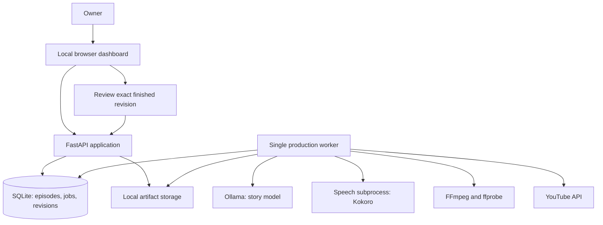

# Nox Stories — architecture v1

Planning baseline: 17 October 2026. This document specifies the proposed system; it does not represent an implemented or benchmarked application.

## 1. Product and decisions

Nox Stories turns a story brief into a 15–20 minute English narrated video, using a local language model, local speech synthesis, and a static background. Nox is the channel's recurring narrator, with a consistent personality, voice, and visual identity.

Confirmed requirements:

- Runs on the owner's M2 Mac with 8 GB unified memory.
- Genres include fantasy, horror, and sweet/wholesome stories.
- Story generation and voice synthesis run locally.
- One simple background image per video initially.
- A dashboard manages the production process.
- English narration for version one.
- Starting voice selected after Phase 0 audition: Kokoro `am_michael`, American English, initial speed 0.95. A 16-minute-17-second full-length hardware/media sample passed validation; story model quality remains provisional. See `phase0/RESULTS.md`.
- Generation is automatic; the owner reviews the finished package before publishing.

Proposed defaults:

- Target duration: 18 minutes; valid finished duration: 15–20 minutes including intro/outro.
- One owner, one Mac, one connected YouTube channel.
- 1920×1080 landscape video, 24 fps, H.264/AAC MP4.
- Music and subtitles optional and off initially.
- Backgrounds are supplied assets or reusable templates; local image generation is outside v1.
- Horror intensity, audience, and ending style are separate settings. “Wholesome” is an available tone, rather than a restriction silently applied to every genre.

## 2. System layout



This is one local application with a separate worker process. The API remains responsive while the worker performs long tasks. SQLite holds the durable queue; closing the dashboard does not cancel production.

Heavy work is globally serialized across all episodes: LLM generation, speech synthesis, and video rendering do not run simultaneously. Model previews also use this same resource lock. A queued episode waits while another episode owns it.

### Selected stack

| Component | Choice | Reason |
| --- | --- | --- |
| Dashboard | React + TypeScript + Vite | Episode editor, media preview, queue and settings |
| API and orchestration | Python 3.11 + FastAPI + Pydantic | Shared language with speech and media tooling; validated contracts |
| Database | SQLite in WAL mode; SQLAlchemy + Alembic | Durable local state with migrations |
| Queue | SQLite jobs table + one Python worker | Restart recovery without another queue service |
| Story runtime | Ollama localhost HTTP API | Local model loading, inference, and unloading |
| First story candidate | `qwen3:4b-instruct-2507-q4_K_M` | Small quantized instruct model; must pass local evaluation |
| Lower-memory candidate | `qwen3:1.7b` | Benchmark separately if the 4B model causes memory pressure |
| First speech candidate | Kokoro-82M, English preset | Small local TTS model; audition before choosing Nox's voice |
| Speech fallback | Piper adapter, if required | Alternative local speech engine; select and verify a specific voice |
| Media processing | FFmpeg + ffprobe | Assemble audio/video and inspect actual outputs |
| YouTube | Google Python API client + desktop OAuth | Authorized channel uploads with resumable transfer |
| Credential storage | macOS Keychain | Keep refresh tokens out of the database and logs |

Serve the built dashboard from FastAPI in normal use. Use the Vite development server only during development. Run natively on macOS initially; avoid the extra memory overhead of a container stack.

Model choices are candidates, not a claim that they are the newest or that performance has already been proven. Ollama lists the selected 4B instruct download at roughly 2.5 GB; download size is not runtime RAM usage. [Ollama model catalog](https://registry.ollama.com/library/qwen3/tags)

Kokoro documents an 82-million-parameter speech model and Apache-licensed weights. Use its reference Python implementation first, starting with CPU execution; evaluate Apple acceleration only if needed. [Kokoro repository](https://github.com/hexgrad/kokoro)

Piper's current engine is GPL-3.0; individual voice choices need their own model-card check before adoption. Keep it as a fallback rather than installing two speech stacks initially. [Piper repository](https://github.com/OHF-Voice/piper1-gpl)

## 3. Episode production flow

### A. Create the brief

The owner selects genre, tags, tone, intensity, audience, ending style, target duration, background, and optional seed idea. Each episode snapshots the current Nox profile and settings so later global changes do not alter an existing production unexpectedly.

Example brief: English; fantasy; forgotten library, unlikely friendship, moonlight; warm and mysterious; hopeful ending; 18 minutes.

### B. Plan the story

The LLM produces a validated JSON outline: premise, characters, pronunciation notes, setting, conflict, scene sequence, resolution, and word budget per scene. The system also provides a short list of recent premises to reduce repetition without loading the entire channel history.

Schema validation can verify structure. It cannot prove that the story is original or good.

### C. Write the narration

Generate approximately 6–8 scenes sequentially. Every scene gets the outline, fixed character facts, current continuity summary, and the previous scene's ending. Save each completed scene before generating the next one.

Write spoken prose, not screenplay formatting. Include a short Nox opening and closing. Keep narration text separate from titles, production notes, and pronunciation overrides.

Initial English planning assumption: about 130–150 spoken words per minute, giving roughly 1,950–3,000 words for 15–20 minutes. Calibrate using the actual selected voice. Use target minutes × measured words per minute to allocate scene budgets.

### D. Check and revise the script

Run deterministic checks for empty scenes, unresolved placeholders, repeated paragraphs, and word-budget deviation. Perform one bounded LLM editorial pass for continuity, ending, and requested tone. Save title, description, tags, and thumbnail text while the LLM is already loaded.

Allow up to two targeted repair attempts for malformed or incomplete content, then stop with a reviewable error. The same small LLM's critique is a useful heuristic, not an independent quality guarantee.

### E. Release the LLM and synthesize speech

Explicitly unload the story model before starting speech. Ollama supports immediate unloading through `keep_alive: 0`. [Ollama memory controls](https://docs.ollama.com/faq)

Split narration at sentence/paragraph boundaries into manageable speech chunks. Store exact spoken text, scene ID, chunk order, voice settings, text hash, and measured duration. Save each WAV atomically. Resume from completed chunks after interruption.

Nox uses one selected voice and fixed baseline pacing. Pronunciation overrides affect spoken input without rewriting the display script. Do not silently change voices mid-episode if synthesis fails.

### F. Assemble audio and enforce duration

Concatenate speech with deliberate pauses; normalize narration and check for empty audio, unexpected silence, clipping, and missing chunks. Optional music is mixed below speech using an explicitly selected licensed track.

Measure the assembled audio. Accept only if the finished timeline is 900–1,200 seconds. If outside the range, calculate the word-budget correction, exit the speech process, revise selected scenes with the LLM, unload it, and resynthesize affected chunks. Allow two duration-repair cycles, then require intervention. Do not pad a short story with minutes of silence or distort the voice to meet duration.

If enabled, v1 subtitles are paragraph captions timed from actual chunk boundaries, labeled as approximate. Precise word alignment is a later feature. Store timing from the final assembled timeline, including all pauses.

### G. Prepare visual assets and render

Use one approved background, optional small Nox portrait/logo, and optional title overlay. Generate a separate thumbnail from a reusable image/text template. Snapshot the chosen assets into the episode revision.

FFmpeg loops the static image to the exact audio timeline and writes an MP4 with fast-start metadata. Probe available encoders during setup; use VideoToolbox if it passes a sample render, otherwise use a bounded-thread software encoder. Stream media through subprocesses rather than holding whole videos in Python memory.

### H. Validate the finished package

Use ffprobe to confirm readable audio/video streams, resolution, duration, and approximate audio/video duration agreement. Extract sample frames to verify layout. Confirm metadata, thumbnail, and current content settings exist. Automatic checks do not replace listening for narration quality.

Save a package manifest with input/output hashes, model identifiers, prompt/profile versions, voice settings, and validation results. Rendering completes into `awaiting_review`.

### I. Review, approve, and publish

The dashboard shows the exact script, audio, video, thumbnail, title, description, tags, audience settings, and intended visibility/time. The owner can edit or regenerate a scene, replace the background, or change metadata.

Approval records the exact package revision and publishing settings. Any later change to approved content or publishing settings revokes approval. Publishing requires a current approved revision and an explicit publish/schedule action. There is no automatic public publishing in v1.

Upload privately first using a resumable session. Save session progress and the returned YouTube video ID before subsequent work. Attach the thumbnail and optional captions, observe YouTube processing status, then apply the approved public visibility or scheduled publication time. Track `uploaded`, `processing`, `scheduled`, and `published` separately.

YouTube account verification is required for videos longer than 15 minutes. [YouTube length eligibility](https://support.google.com/youtube/answer/71673)

Use the current upload API's explicit privacy fields rather than its default, and verify project/channel eligibility with a private integration test. The current upload reference and older revision history differ on historical unverified-project restrictions; do not assume an old rule still applies universally. [Current upload reference](https://developers.google.com/youtube/data/reference/rest/v3/videos/insert)

Resumable sessions allow transfer recovery. If completion becomes ambiguous, reconcile the existing session and stored video ID; do not automatically create a second upload. If reconciliation is impossible, surface a manual check in the dashboard. [YouTube resumable uploads](https://developers.google.com/youtube/data/guides/using_resumable_upload_protocol)

## 4. Nox's identity

Store a versioned narrator profile with name, personality, language, voice/model identifiers, speed, pronunciation dictionary, intro/outro style, portrait, and channel wording.

Proposed creative direction, awaiting the owner's choices: a calm storyteller with a warm, slightly mysterious delivery. Nox is the framing narrator; characters remain part of the story. All dialogue uses Nox's voice initially. Nox's appearance and exact personality remain open; American English Michael is the selected starting voice.

Voice auditions should use the same short passage with dialogue, suspense, fantasy names, and a gentle ending. The owner selected American English Michael after listening to the Phase 0 samples. Other aspects of Nox's personality and visual identity remain open.

## 5. Dashboard and owner flow

| Screen | Purpose and primary actions |
| --- | --- |
| Overview | Current job, queue, review count, failures, disk/model health |
| New episode | Brief, tags, duration, template; enqueue production |
| Episode detail | Stage timeline, script by scene, audio/video preview, logs; edit, regenerate, pause, resume, cancel |
| Review and publishing | Exact package review, approval, publish/schedule, YouTube progress and link |
| Library | Search episodes by genre, date, status; download artifacts |
| Nox and assets | Voice auditions, profile, backgrounds, portrait, optional music |
| Settings | Local providers, memory limits, storage, connected channel, schedule timezone |

Main owner flow: choose tags → enqueue → watch progress if desired → receive an in-app review-ready state → preview/edit → approve and publish or schedule → see the resulting YouTube link.

Use simple polling every few seconds for progress initially. Show stage, completed scenes/chunks, elapsed time, and errors. Avoid fabricated whole-pipeline percentages or completion estimates until measured data exists.

## 6. State, storage, and contracts

Keep episode content revisions separate from job execution state and publishing state.

Production stages: `preflight → outline → script → script_check → speech → audio_check → assets → render → package_check → awaiting_review`.

Execution statuses: `queued`, `running`, `pause_requested`, `paused`, `failed`, `cancelled`, `completed`.

Publishing statuses: `not_requested`, `approved`, `uploading`, `uploaded_private`, `processing`, `scheduled`, `published`, `failed`, `needs_reconciliation`.

Core records:

- `episodes`: identity, brief, active revision, timestamps.
- `episode_revisions`: immutable settings/profile snapshots, content and package manifest hashes.
- `scenes`: ordered content revisions, continuity facts, word budgets.
- `artifacts`: file path, type, checksum, revision and producing stage.
- `jobs` / `stage_runs`: stage, status, attempts, timestamps, lease/heartbeat, error summary.
- `events`: ordered progress and audit entries; no credentials.
- `approvals`: package hash, revision, channel, visibility/time, approval/revocation timestamps.
- `publish_attempts`: protected session reference, bytes acknowledged, YouTube ID, observed status.
- `assets` / `nox_profiles` / `settings`: reusable inputs and versions.

Media belongs on disk, not in SQLite blobs. Token credentials belong in Keychain. Resumable session URLs are sensitive and must not appear in dashboard logs or exports.

Suggested layout once implementation starts:

```text
Nox Stories/
  ARCHITECTURE.md
  backend/                 API, schemas, database, worker, pipeline
  frontend/                dashboard
  config/                  prompt and template versions
  assets/                  approved reusable visual/audio assets
  data/
    nox.sqlite3
    episodes/<episode-id>/revisions/<revision-id>/
      brief.json
      outline.json
      scenes/
      narration/chunks/
      narration/final.wav
      metadata.json
      thumbnail.jpg
      video.mp4
      manifest.json
```

Principal API contracts:

- `POST /api/episodes`, `GET /api/episodes`, `GET /api/episodes/{id}`.
- `POST /api/episodes/{id}/generate` and `/pause`, `/resume`, `/cancel`.
- `PATCH /api/episodes/{id}/scenes/{scene_id}` creates a revision; `/regenerate` enqueues a bounded scene job.
- `GET /api/episodes/{id}/events?after=...` and protected artifact preview/download routes.
- `POST /api/episodes/{id}/approve` requires current revision and package hash.
- `POST /api/episodes/{id}/publish` requires current approval and records a unique publish operation.
- Settings/profile/assets routes and a loopback-only OAuth callback.

An approved package must be immutable while uploading. Every mutation checks revision preconditions so a stale browser view cannot overwrite newer work.

## 7. Reliability and resource rules

- Preflight checks model availability, encoder, output directory, selected assets, disk space and configuration. Internet is required for setup downloads and publishing, not normal generation after setup.
- Start with a 4,096-token context and bounded scene outputs. Permit 8,192 only if measured memory headroom allows it. Large advertised context limits are not the operating target.
- One loaded story model and one inference request. Unload after the complete writing/metadata stage, then run speech in a subprocess and exit it before rendering.
- Worker claims jobs transactionally with a lease. An expired lease does not justify starting another worker until the old process is confirmed stopped. A singleton lock prevents concurrent heavy work.
- Use atomic temporary-file writes and stage manifests. After a crash, reconcile valid artifacts with database state before rerunning work.
- Reuse an artifact only when its text, voice, profile, template and relevant settings hashes match.
- Script edits invalidate affected speech chunks, assembled audio, captions, video, validation, and approval. Background changes invalidate thumbnail/video and approval. Metadata edits invalidate approval without regenerating narration.
- Retry transient local errors at most twice with delay. Network upload retry respects API responses and backoff; authentication and quota problems wait for user action or the applicable reset. Retry counters and errors survive restart.
- Pause at the next safe scene/chunk boundary. Cancel terminates active subprocesses where possible and preserves completed artifacts. Already submitted YouTube changes require separate reconciliation.
- Protect active, approved, or uploading revisions from cleanup. Offer explicit cleanup of obsolete intermediates while retaining published packages and provenance by default.
- Back up SQLite with a consistent snapshot plus matching artifact directories. Restore verification is part of reliability testing.
- A sleeping or shut-down Mac cannot generate. Local schedule triggers run only while the app is running; a missed generation trigger creates at most one catch-up job. Once an upload is processed and scheduled on YouTube, publication no longer depends on the Mac staying awake.
- Store schedule times in UTC and display them in Asia/Kolkata initially.
- Bind API and model services to loopback. Restrict browser origins, authenticate sensitive local actions with a local session, validate file paths, and invoke subprocesses with argument arrays rather than shell-interpolated story text.

## 8. Build sequence and acceptance criteria

### Phase 0 — prove the hardware and voice

Run model candidates on representative fantasy, horror, and gentle-story briefs. Measure actual memory pressure, swapping, generation time and coherence. Audition English voices and synthesize a 2-minute sample, then test a full-length narration and static-image render.

Exit: select a story model and voice that finish reliably on this Mac while the API/dashboard remain usable. Record timing and memory observations. If the 4B model fails, test the smaller candidate explicitly; do not silently trade quality for speed.

### Phase 1 — local production pipeline

Implement versioned briefs, scene writing, chunk speech, duration repair, media assembly, package validation and durable jobs. Produce three complete 15–20 minute episodes across the proposed genres.

Exit: valid MP4s; stable voice; complete endings; recovery after interrupting a scene or speech chunk; no overlapping heavy tasks.

### Phase 2 — dashboard and review

Implement queue, episode editor, previews, progress, settings, asset selection, revision invalidation and approval.

Exit: owner can create, inspect, repair and approve an episode entirely through the dashboard. Editing approved material revokes approval and only necessary downstream stages rerun.

### Phase 3 — YouTube integration

Configure desktop OAuth and channel eligibility. Test private upload, interrupted-upload recovery, thumbnail, processing tracking, approved public publication and scheduling. Confirm the uploader cannot publish an unapproved revision or duplicate an ambiguous completed upload.

Exit: approved package appears on the intended channel with the intended metadata and visibility; schedule behavior verified.

### Phase 4 — repeatable operation

Add optional generation schedules, storage cleanup, backup/restore and health indicators. Test restart recovery and missed-trigger behavior. Keep review before publishing.

Later extensions: more backgrounds, slow image motion, precise captions, additional languages, improved speech providers, analytics and an explicitly enabled full-auto publishing mode. These should fit existing provider interfaces rather than require a rewrite.

## 9. Open choices and next action

The architecture can proceed without deciding Nox's appearance immediately. Before producing channel-ready material, choose the exact voice/accent, Nox personality and portrait, default horror intensity/audience, and channel branding. Confirm YouTube channel availability during the integration phase.

Next implementation action after architecture agreement: Phase 0 hardware and narration spike. Do not build the full dashboard before proving that the story/voice combination can produce a satisfactory full-length episode on the available machine.
